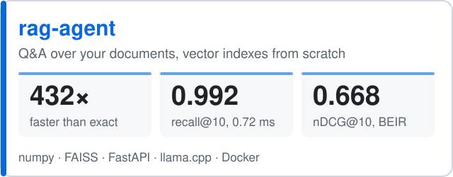
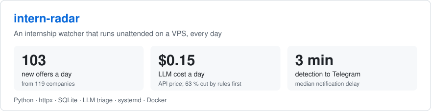
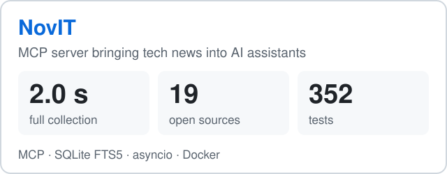

<h1 align="center">Rayân Mouahid</h1>

  Engineering student at CY Tech, looking for an AI engineering internship from March 2027. 
  I build retrieval and agent systems and measure them: every figure below comes from a script in its repository.

  <a href="https://www.linkedin.com/in/rmouahid">LinkedIn</a> ·
  <a href="mailto:prorayanmouahid@gmail.com">prorayanmouahid@gmail.com</a> ·
  <a href="https://docs.google.com/document/d/1AUHSf6siZ9bExP_u02Gcvrgx173s5qi34O4Ov_In1m8/export?format=pdf">CV</a>

<a href="https://github.com/rmouahid/rag-agent">
  <picture>
    <source media="(prefers-color-scheme: dark)" srcset="cards/rag-agent-dark.svg">
    
  </picture>
</a>

Benchmark

 

Reports: <a href="https://github.com/rmouahid/rag-agent/blob/main/docs/benchmarks/scale.md">scale study</a> · <a href="https://github.com/rmouahid/rag-agent/blob/main/docs/benchmarks/sift.md">SIFT1M</a> · <a href="https://github.com/rmouahid/rag-agent/blob/main/docs/benchmarks/beir_scifact.md">BEIR SciFact</a>

<a href="https://github.com/rmouahid/intern-radar">
  <picture>
    <source media="(prefers-color-scheme: dark)" srcset="cards/intern-radar-dark.svg">
    
  </picture>
</a>

Daily metrics

 

Report: <a href="https://github.com/rmouahid/intern-radar/blob/develop/docs/metrics.md">docs/metrics.md</a>

<a href="https://github.com/rmouahid/NovIT">
  <picture>
    <source media="(prefers-color-scheme: dark)" srcset="cards/novit-dark.svg">
    
  </picture>
</a>

Demo

 

Timing: <a href="https://github.com/rmouahid/NovIT/blob/main/scripts/profile_scrapers.py">scripts/profile_scrapers.py</a>

